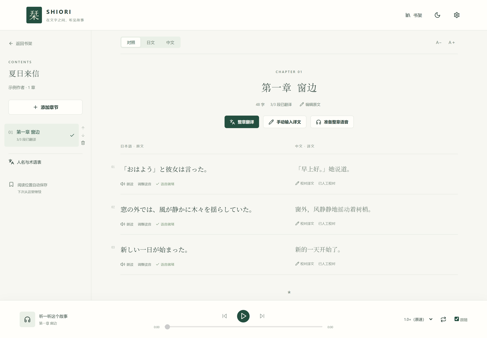

# 栞 Shiori · 日中对照小说阅读器

[](https://github.com/ac-1e9plus7/novel-reader/actions/workflows/ci.yml)

把粘贴的日文小说整理成可校对、可朗读的中文对照阅读内容。React / TypeScript 提供书架与阅读界面，Go 管理模型请求、任务和音频，SQLite 保存本机数据。



## 功能

- **书架与章节**：创建小说、粘贴日文、预览段落、保存原文版本，支持章节上移、下移和删除。
- **对照翻译**：单段和整章翻译；整章按段建立独立任务，每个任务只翻译一个段落。
- **阅读与校对**：日中对照、仅日文、仅中文；人工译文保护、深浅色、字号和手机布局。
- **手工译文**：逐段或整章填写，可只保存部分段落；没有译文或翻译服务不可用时仍可阅读原文、调整读音和保存进度。
- **日语朗读**：OpenAI 兼容 / OpenRouter / Azure Speech；分段播放、连播、循环、倍速、读音修正和整章准备。
- **高级语音设置**：生成并发量默认 10，可在网页调整为 1–32，实时生效并持久保存。
- **音频缓存**：WAV 即时可用，后台 FLAC 无损压缩；纯 Go FLAC 解码保证移除 FFmpeg 后已有缓存仍可播放。
- **持久化任务**：处理记录、取消、部分失败重试、重启后继续；阅读和播放位置存入 SQLite。
- **维护支持**：用量记录、缓存清理、离线模拟测试、Windows / macOS 脚本和 Linux CI。

## 快速开始

需要 **Go 1.24+、Node.js 24+**。FFmpeg 可选，用于 FLAC 压缩与 MP3 解码。

**Windows（PowerShell）**，在项目根目录执行：

```powershell
.\scripts\windows\setup.ps1
# 编辑生成的 .env，填写 Responses 与 TTS 配置
.\scripts\windows\start.ps1 start
```

停止：

```powershell
.\scripts\windows\start.ps1 stop
```

**macOS（Terminal）**：

```bash
./scripts/macos/setup.sh
# 编辑生成的 .env，填写模型配置
./scripts/macos/start.sh start
# 查看状态 / 停止
./scripts/macos/start.sh status
./scripts/macos/start.sh stop
```

启动后打开 [http://127.0.0.1:8787](http://127.0.0.1:8787)。脚本按平台分别位于 `scripts/windows/` 和 `scripts/macos/`。

### 配置从哪里开始

安装脚本只在 `.env` 不存在时复制 `.env.example`，不会覆盖已有配置。注意区分：

- **程序内置默认**：未设置变量时使用 OpenAI 兼容地址、空模型/密钥和 `gpt-4o-mini-tts`。
- **setup 生成配置**：`.env.example`，适合先启动再逐项填写。
- **推荐配置模板**：`config/deepseek-gemini.env.example`，包含 DeepSeek Responses + OpenRouter Gemini TTS；需要手动复制，不会自动生效。

完整字段、优先级和供应商差异见[服务配置](docs/configuration.md)。

先创建小说，再添加章节，保存后即可阅读和朗读日文。需要中文时，可点击「手动输入译文」填写、在段落旁使用「翻译此段」，或点击「整章翻译」批量安排单段任务。点击「朗读」按需生成音频，或点击「准备整章语音」；这些功能不要求先有译文。

## 无密钥体验

不配置任何模型密钥也可以：

1. 创建小说和章节，保存日文原文。
2. 在对照或中文模式下手工填写、校对译文。
3. 阅读原文、切换章节、调整字号/主题、维护术语和保存阅读进度。

自动翻译和新的语音生成需要对应的服务配置。已经缓存的音频不需要再次调用模型。

## 数据与隐私

- 小说原文、译文、任务、术语和阅读进度保存在本机 `DATA_DIR`；音频保存在 `DATA_DIR/audio/`。
- 启用自动翻译或语音时，相关文本会发送到你配置的 LLM / TTS 服务。服务商如何处理或保存这些文本由其条款决定。
- 模型密钥只放在后端环境变量或 `.env`，不会发送给浏览器；项目没有额外的遥测或上传通道。
- 模型调用会产生费用，具体由配置的服务收取；取消任务不保证远端停止计费。
- 默认只监听 `127.0.0.1`。对外开放前必须自行增加认证、TLS 和访问控制。

详见[运维、限制与故障排查](docs/operations.md)。

## 已知限制

- 单用户、本机优先，没有账户、权限或多租户隔离。
- 同一 `DATA_DIR` 只允许一个服务进程。
- 取消任务不保证远端停止计费；崩溃后重试可能再次收费。
- 当前没有原文历史版本的恢复界面，恢复依赖备份或后续工具。
- 真实模型的翻译质量、读音自然度和供应商兼容性需要单独验收。
- 桌面 Chromium 和 Pixel 7 尺寸由自动化测试覆盖；其他浏览器未列入 CI。

完整清单和排障方法见[运维、限制与故障排查](docs/operations.md)。

## 文档

| 文档 | 内容 |
| --- | --- |
| [安装与启动](docs/getting-started.md) | Windows / macOS 脚本、手动启动、数据和备份 |
| [服务配置](docs/configuration.md) | 配置来源、Responses、TTS、超时、完整环境变量 |
| [Gemini TTS 接入](docs/gemini-tts.md) | OpenRouter / Gemini 声音与原生接口区别 |
| [使用指南](docs/reading.md) | 导入、校对、术语、播放与恢复 |
| [运维与限制](docs/operations.md) | 日志、备份恢复、安全边界、隐私、费用、排障 |
| [升级与迁移](docs/upgrading.md) | schema 版本、自动迁移、离线迁移和回滚 |
| [架构与数据流](docs/architecture.md) | 组件、请求路径、任务生命周期、数据库和缓存键 |
| [HTTP API](docs/api.md) | 请求/响应、状态码、SSE 和输入限制 |
| [开发指南](docs/development.md) | 文件职责、开发启动、检查命令 |
| [实现与维护约束](docs/constraints.md) | 数据一致性、任务、缓存与密钥规则 |
| [测试策略](docs/testing.md) | 回归用例、模拟服务、CI 与验收方法 |
| [真实验证记录](docs/verification.md) | 显式付费验证工具与历史结果 |
| [文档索引](docs/README.md) | 完整文档地图、术语和维护约定 |
| [变更记录](CHANGELOG.md) | 版本变化和文档调整 |

## 开发与检查

- 后端：`cd backend && go test ./... && go vet ./...`
- 前端：`npm --prefix frontend run build && npm --prefix frontend run test:e2e`
- 文档：`node scripts/check-docs.mjs`
- 协作规则：见 [AGENTS.md](AGENTS.md)；Claude Code 入口见 [CLAUDE.md](CLAUDE.md)。

## 许可证

本项目使用 [Apache License 2.0](LICENSE)，版权信息见 [NOTICE](NOTICE)。
